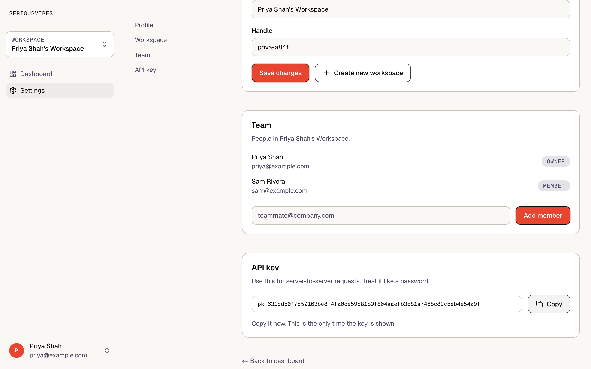

<h1 align="center">seriousvibes</h1>

<p align="center"><strong>A serious starter for vibe coders.</strong></p>

<p align="center">A Next.js 15 + Hono + Postgres starter for building multi-tenant SaaS with a coding agent.</p>

<p align="center"><a href="https://sptr11.github.io/seriousvibes/">Website</a> · <a href="#quickstart">Quickstart</a> · <a href="#whats-included">What's included</a> · <a href="#make-it-yours">Make it yours</a></p>

---

seriousvibes gives you a working app (auth, workspaces, API keys, tests) and an `AGENTS.md` that tells your coding agent the project's rules. Every query is scoped to a workspace, tests come first, styles use design tokens, and UI text follows a copy guide. The existing code already follows these rules, so the agent has correct examples to copy.



## What's included

| Problem | What's included | Docs |
|---|---|---|
| Data leaking between tenants | Middleware resolves the workspace. Every query filters on `workspace_id`. Each route must test the cross-workspace case. | [`SECURITY.md`](docs/SECURITY.md) |
| Code shipped without tests | TDD is required by `AGENTS.md`. Vitest calls routes in-process with Hono's `app.request()`, and the suite runs in under a second. | [`TESTING.md`](docs/TESTING.md) |
| Hardcoded colors | Semantic CSS variables in `globals.css`, mapped into Tailwind classes. | [`DESIGN_SYSTEM.md`](docs/DESIGN_SYSTEM.md) |
| Vague UI copy and error messages | A copy guide with banned words, error message patterns and CTA rules. | [`COPY_GUIDE.md`](docs/COPY_GUIDE.md) |
| Deploys that fail silently | A `/health` route that only answers when both the web and API processes are up, and a deployment guide covering port collisions and failed migrations. | [`DEPLOYMENT.md`](docs/DEPLOYMENT.md) |
| Agents building more than you asked for | A scope rule: build only what the prompt asks for, and write tests if you finish early. | [`AGENTS.md`](AGENTS.md) |

## Using it with an agent

1. Fork the repo.
2. Your agent reads the rules from `AGENTS.md`. Codex, Cursor, GitHub Copilot and most other coding agents load it automatically. Claude Code reads `CLAUDE.md`, which imports `AGENTS.md`. If your tool uses a different rules file, point that file at `AGENTS.md`.
3. Scope each prompt to one feature. `AGENTS.md` tells the agent to build only what you asked for and to write tests if it finishes early.

## Quickstart

Requires Node 20+ and a Postgres database.

```bash
npx degit sptr11/seriousvibes myapp
cd myapp && git init
npm install
cp .env.example .env     # set DATABASE_URL and JWT_SECRET
npm run migrate
npm run dev              # web on :3000, api on :3001
```

```bash
npm test                 # unit tests (vitest)
npm run test:e2e -w web  # end-to-end tests (playwright)
npm run typecheck
```

## Make it yours

Do these in order, before your agent writes product code. Every file it writes afterwards inherits them.

### 1. Name and placeholder copy

Replace `seriousvibes` with your product name. `grep -rl seriousvibes --exclude-dir=node_modules .` lists every file, including the package names, page metadata in `web/src/app/layout.tsx`, and the landing and login pages. Rewrite the landing page copy in `web/src/app/page.tsx`. It describes this starter, not your product. Delete `site/` and `.github/workflows/pages.yml`; they're this starter's own website. Clear `docs/ITERATIONS.md` below the format header so your log starts empty.

**Why:** an agent copies whatever text is nearby. Leftover starter copy ends up in your product.

### 2. `AGENTS.md`

Replace the intro in the root `AGENTS.md` with one paragraph on what your product does and who uses it. Under "Hard rules", add the rules specific to your domain, for example "amounts are stored in cents" or "every form belongs to a workspace". Keep the per-package files (`api/AGENTS.md`, `web/AGENTS.md`) in sync as you add routes and pages.

**Why:** this is the only file the agent is guaranteed to read. A rule that isn't written here won't be followed.

### 3. Copy guide

In [`docs/COPY_GUIDE.md`](docs/COPY_GUIDE.md), pick three adjectives for your voice and replace the example ones. Add banned words from your own industry. Rewrite the error-message and CTA examples using your product's nouns ("Couldn't send the invoice", not "Couldn't save the form").

**Why:** an agent writes generic copy unless it has concrete examples to match. Examples in your own vocabulary give it a pattern to copy.

### 4. Design tokens

Change the values in `web/src/app/globals.css`: colors (stored as RGB triples), radius, shadows and motion. To change fonts, swap the `next/font/google` imports in `web/src/app/layout.tsx`. Keep the token names; they're semantic (`--color-accent`, not `--color-coral`). Change the values. [`DESIGN_SYSTEM.md`](docs/DESIGN_SYSTEM.md) covers adding tokens and component variants.

**Why:** components only reference tokens, so a rebrand is a one-file change. If the agent sees a hex value in JSX, it will add more.

### 5. Tests for every route you add

Each new route file gets a test file next to it (`routes/invoices.ts` → `routes/invoices.test.ts`) with at least four tests: the happy path, invalid input (400), a missing or wrong role (401/403), and a user from another workspace (404). Copy the pattern from [`workspaces.test.ts`](api/src/routes/workspaces.test.ts): mock `pool.query`, call `app.request()`, assert. Write the failing test before the route.

**Why:** the cross-workspace test is the one that catches tenant leaks, and a leak is the bug you can't take back. CI runs `npm test` on every push.

### 6. Production settings

Set `JWT_SECRET` to at least 32 random bytes (migrations refuse to run in production with the default) and `CORS_ORIGIN` to your domain. Point your uptime monitor at `/health`. [`DEPLOYMENT.md`](docs/DEPLOYMENT.md) has the full checklist.

## Design choices

- **SQL with `pg`, no ORM.** Queries use `$1` placeholders, and migrations are idempotent SQL. You can paste any query into `psql`.
- **Auth in the repo.** About 260 lines using `bcryptjs` and `jose`: JWT access tokens, httpOnly refresh cookies, API keys. [`SECURITY.md`](docs/SECURITY.md) shows how to swap in a managed provider.
- **Tailwind and CSS variables.** No CSS-in-JS.
- **npm workspaces.** `api/` and `web/`, with no monorepo tool. `npm run dev` starts both.
- **Multi-tenant from the start.** Adding tenancy later means changing every route.

## Not included

- Marketing pages and a blog
- Pricing, billing and usage metering
- Admin dashboards

Add them once you have users who need them.

## Who it's for

Teams and solo developers building a multi-tenant SaaS with a coding agent. For a single-user prototype, `create-next-app` is lighter.

## Contributing

If your agent shipped a bug these rules should have caught, [open an issue](../../issues) describing it.

## License

[MIT](LICENSE)
